<p align="center">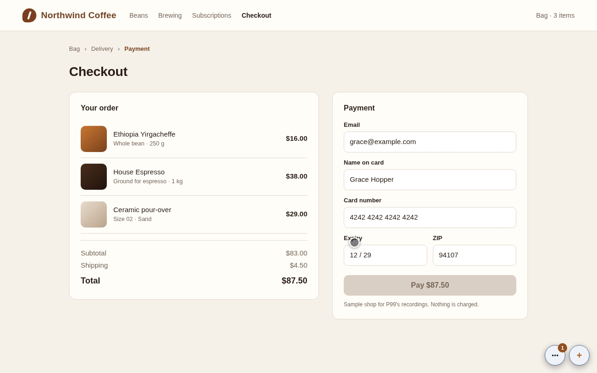</p>

# P99

[](https://github.com/gmrdad82/p99/tags)

P99 is issue and feedback reporting for any website, part of [PITO MD](https://pitomd.com). The people you invite see a small "+" on your site; it opens a panel where they file a bug, an idea, an improvement, a question or a task, with a capture of the screen, marked regions and files, and follow the replies. You and your agents answer from the terminal: `p99` alone opens the inbox in the terminal (also `p99 tui`), and its commands are a CLI with `--json` for scripts and agents.

Cloudflare is the whole infrastructure: one Worker, one D1 database and one R2 bucket per Cloudflare account, mounted on each site's own domain at `/_p99/*`. The page talks only to its own origin. There is no other backend, no CORS, no framework, no build step and nothing from your stack.

Works on Linux and macOS (Windows through WSL). The widget runs in any modern browser.

P99: got questions or doubts? [Ping me on Discord](https://discord.gg/XsNcn3kYzn).

## The numbers

| | |
| --- | --- |
| What every page downloads | **2,044 bytes** gzipped: the loader as served, nothing else |
| Loader start to the "+" painted | **11.8 ms** cold, **4.5 ms** warm |
| Page navigation to the "+" painted | **44.5 ms** cold, **16.9 ms** warm |
| Click to the panel's form on screen | **55.8 ms** cold: panel and styles load only then (24.8 KB gzipped), and the capture code right after the form shows |
| A manager's click on "Board" to the board with its cards | **193 ms** cold: the board's code loads only then (9.9 KB gzipped), with the board from the Worker |
| Worker, p50 and p99 per request | **11.6 / 19.9 ms** the loader, **17.8 / 29.6 ms** an item with its thread, **19.5 / 33.0 ms** a board, **25.6 / 42.1 ms** a list of 50, **37.6 / 82.3 ms** a new item, **53.4 / 95.4 ms** a move, on a local `wrangler dev`, not Cloudflare's edge |
| CLI start-up | **0.7 ms** `p99 --version`, **0.9 ms** `p99 --demo list` |
| TUI start to its first frame at 120×34 | **1.6 ms** |
| TUI frame time at 120×34 | **0.05 to 0.12 ms** average; the board's worst frame while a card is dragged and slides **0.29 ms**: 120 fps leaves 8.33 ms |
| Backend | **0** servers: one Cloudflare Worker, D1 and R2 per account |
| Worker runtime dependencies | **0** (wrangler only to run its tests) |
| p99 binary | **6.9 MB** (3.1 MB as the Linux release download), 14 direct crates, the Worker and widget embedded |

Measured on 2026-10-20 for 1.8.0 on an AMD Ryzen 9 9950X (32 threads), with the load average of the machine's other work noted for each:

- Sizes with `gzip -9`: the loader as a host with no placement settings gets it (`bin/budget`), the panel, styles, capture and board code as the Worker serves them.
- Browser times in headless Chromium 154 on localhost against a local Worker, each the median of 5 runs of 10 page loads, at a load average of 26 to 30, where "painted" is the first animation frame with the button (so times snap to 16.7 ms frames). Cold is a fresh browser context, warm a reload in it. Alternated run by run with 1.7.0 at a load average of 50 to 92, the two were the same within the noise (loader start to the button 9.3 and 9.0 ms cold, click to the form 132 and 144 ms). The board time is from the pointer going down on "Board" to the board on screen with its cards, in a fresh context each time, against the Worker on a local `wrangler dev` with 3 boards and 22 items, the median of 5 runs of 10 at a load average of 11 to 13.
- Worker times on `wrangler dev` (workerd and local D1 on this machine, not Cloudflare's edge), one request at a time over a kept-alive connection, 400 of each after 30 to warm up, signed as the CLI signs them, on 360 items with 120 comments on 2 hosts and 5 boards, at a load average of 12 to 17.
- CLI and TUI start-up: the whole process, the median of 300 runs after 20 to warm up (`p99 tui --demo --dump 120x34` for the first frame); TUI frame times with `p99 tui --demo --bench 200`; both on the v1.8.0 Linux release binary, at a load average of 12. A first set at a load average of 49 to 52 ran slower (up to 1.2 ms a frame on average, the worst 10.5 ms), from the machine's other work.

<p align="center">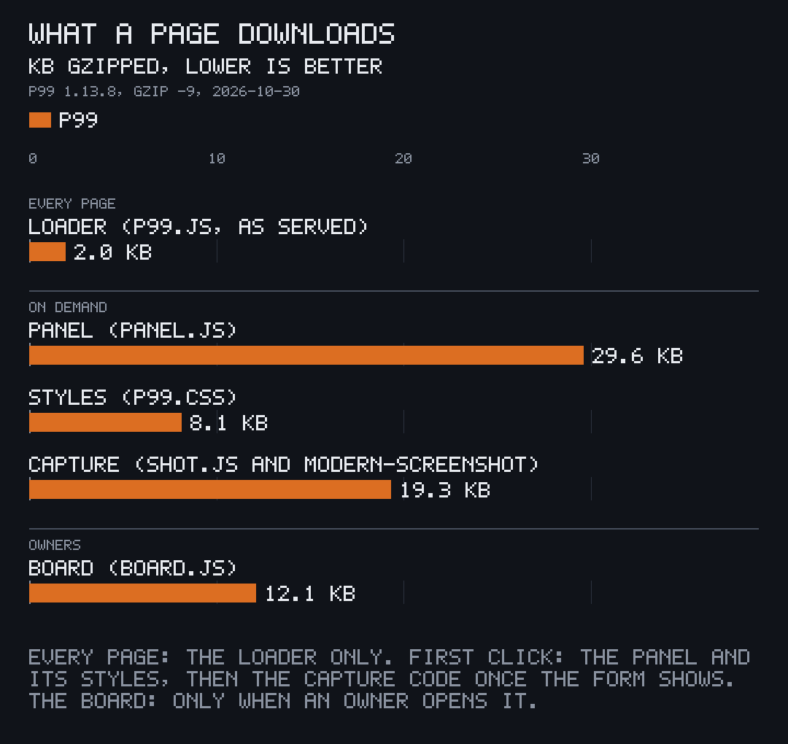 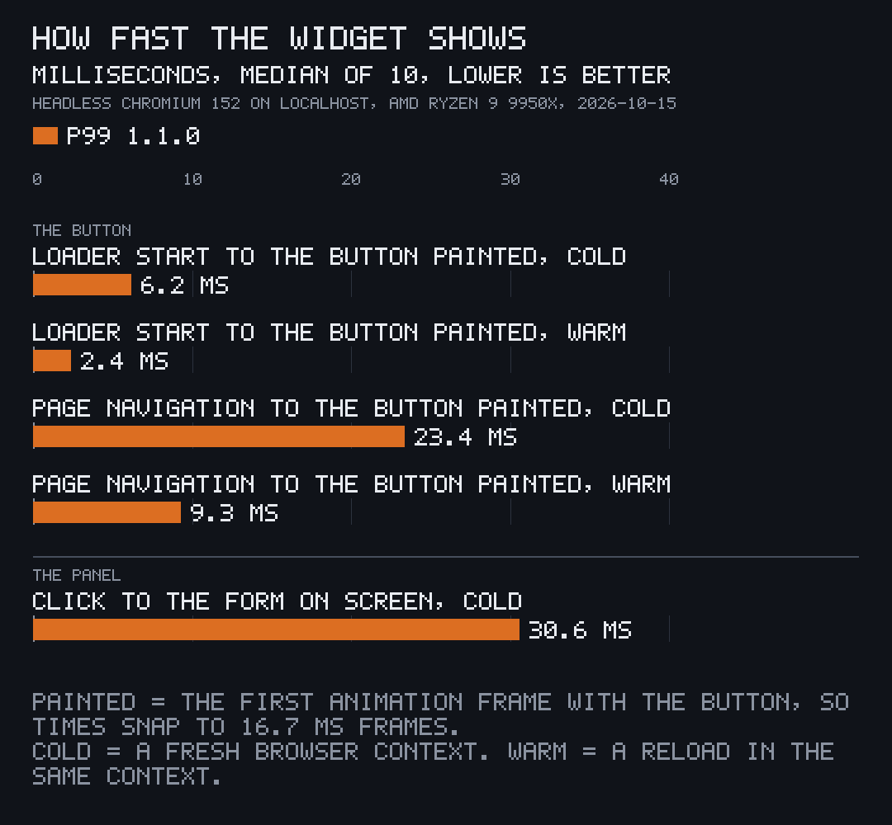</p>

<p align="center">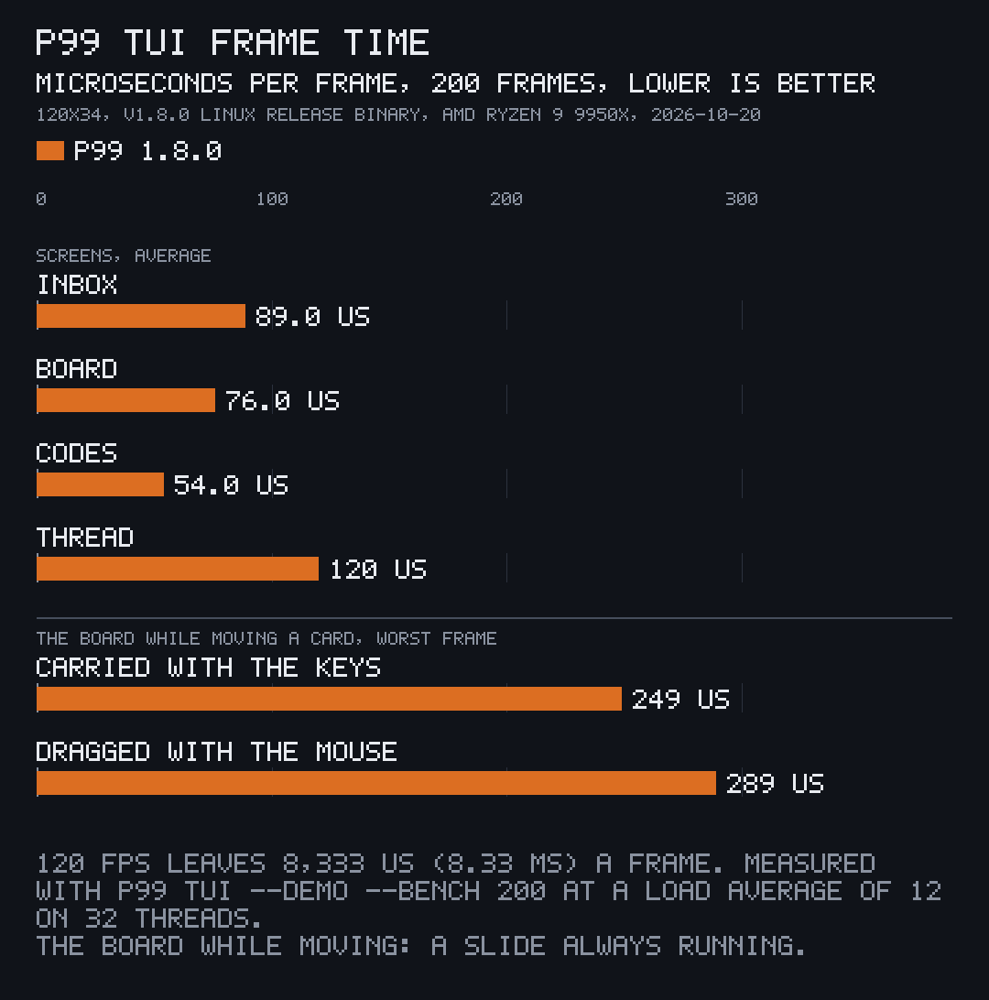</p>

## On your site

**One tag, every page.** The loader is a classic script of about 2 KB that draws the "+" in its own closed Shadow DOM, only for people holding a personal code. For everyone else it reads nothing and draws nothing. It adds one element and one global, `P99`, and works under a strict Content-Security-Policy: no `'unsafe-inline'`, no `eval`, no frames, nothing from another origin.

```html
<script src="/_p99/p99.js" async></script>
```

<p align="center">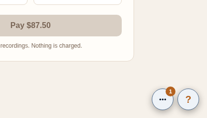 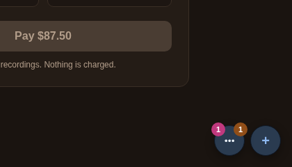</p>

**The panel loads on the first click.** It files bugs, ideas, improvements, questions and tasks, lists what the person sent with what's new for them, and shows each thread with its replies, files, status changes and where its fix has landed. It follows the page's light or dark scheme and takes the site's colours through CSS variables.

<p align="center">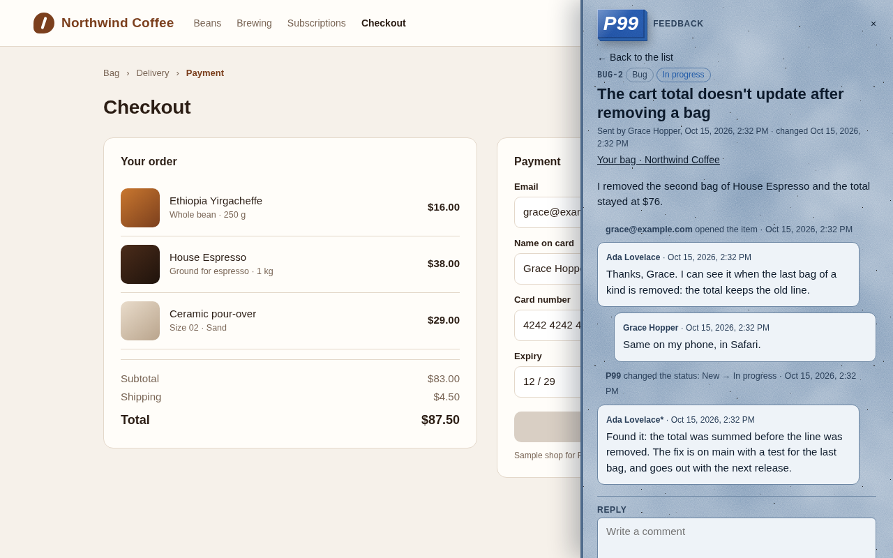 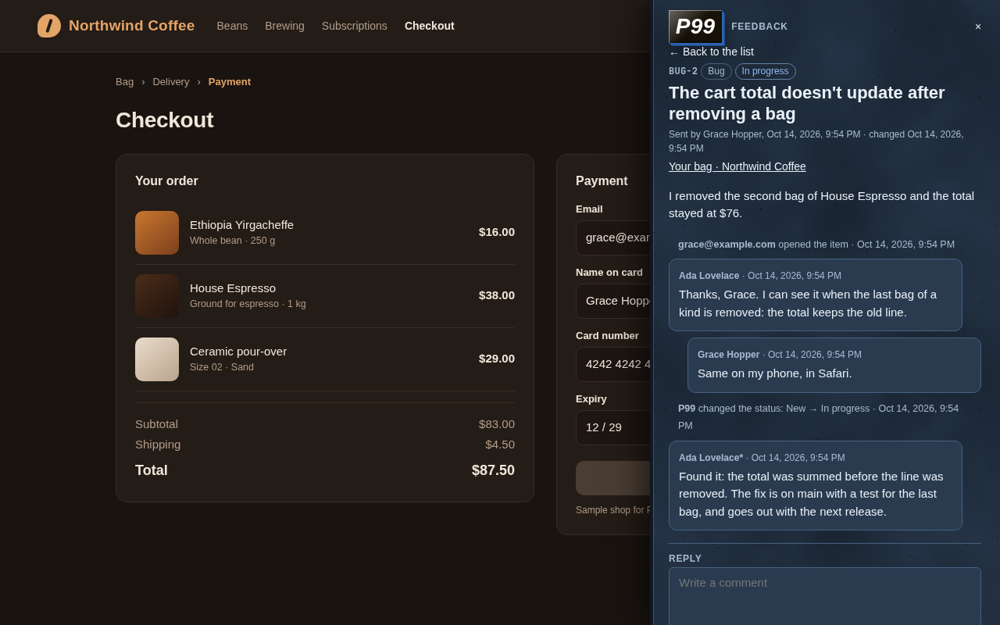</p>

**A board for the people who run the site.** A manager opens "Board" in the panel and gets the site's board over the page: four columns (Inbox, Doing, Review, Done, each one renameable), cards to drag with the mouse, a finger or the keyboard, and boards nested as cards inside other boards, each showing how much of it is done. A move made anywhere, in the browser, the terminal or by an agent, slides into place on every open board within about a second. The board's code loads only when a manager opens it.

**Captures that keep secrets.** The visible screen, the whole page or regions the person marks go with the item. Fields marked `data-p99-redact` (and every password field) are blanked in every capture, the address is kept without its query string and hash, and a site can switch P99 off on any page, such as a checkout's receipt.

<p align="center">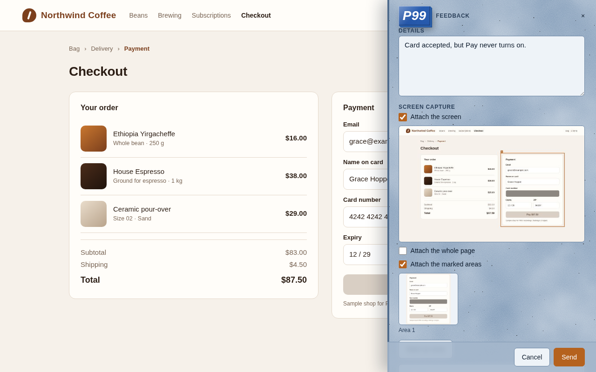</p>

## On a real site

<p align="center">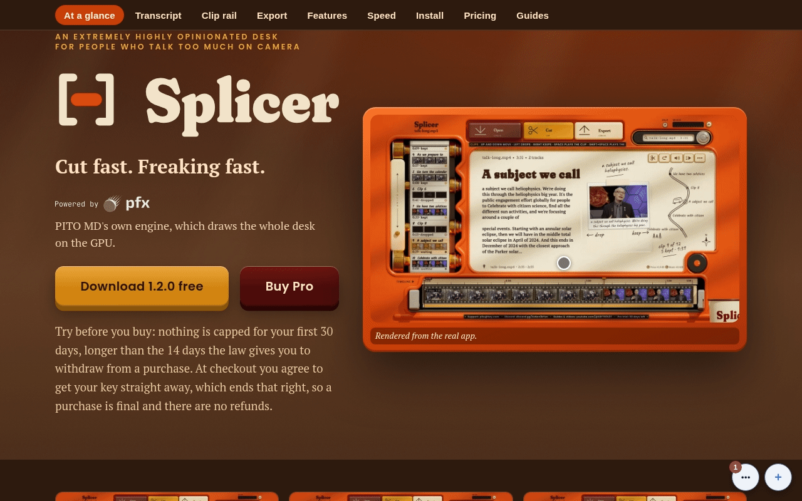</p>

This is P99 on PITO MD's own site, [pitomd.com](https://pitomd.com), recorded on its dev server with a local P99 Worker and sample people. The site added one tag and nothing else; its host config keeps the "+" clear of the site's own back-to-top button.

<p align="center">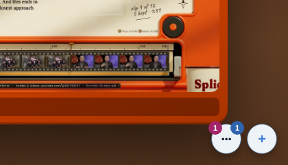 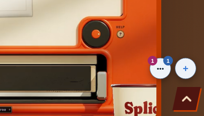</p>

<p align="center">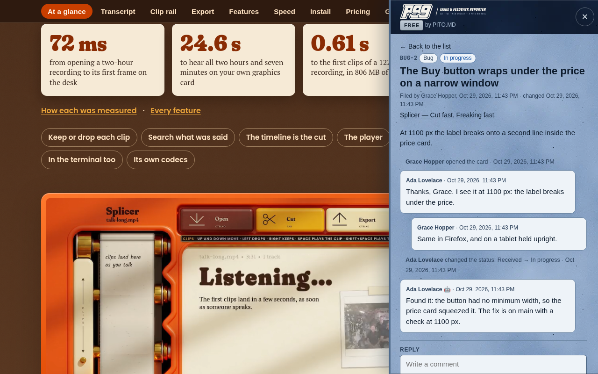 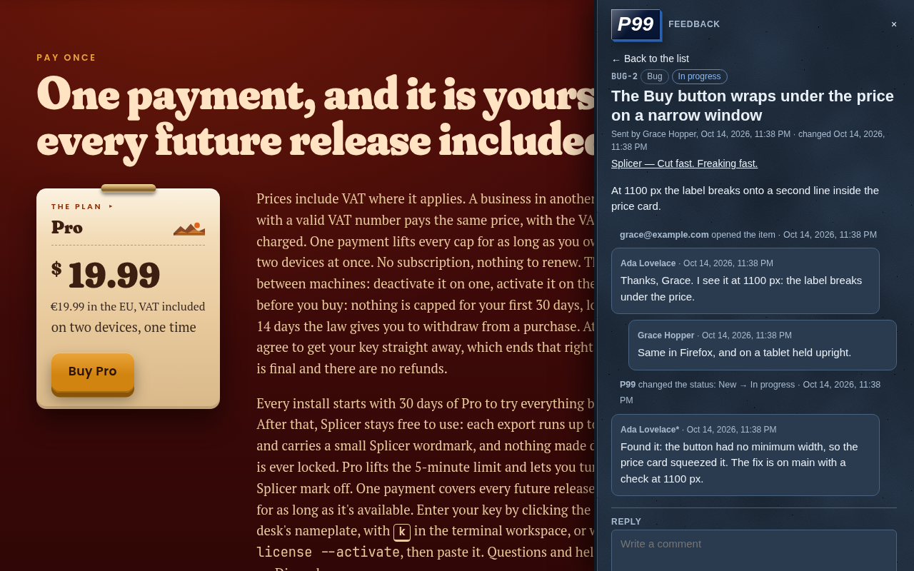</p>

## In your terminal

**The inbox.** `p99` (or `p99 tui`) shows every item across your sites and Cloudflare accounts, or one site at a time, with its host and its label on every row. Open a thread to read it, reply, add an internal note, move it to another label with `m` (the labels on your boards), or assign it. People are usernames, made from their names and changed by each person for themselves, so an assignee shows as `@grace.hopper` with a disc drawn from it, never an e-mail.

<p align="center">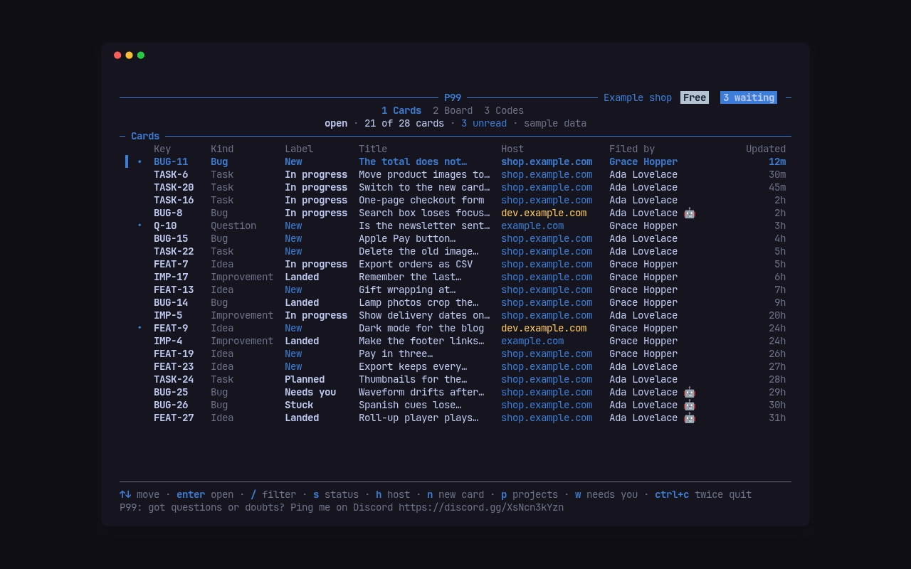</p>

<p align="center"> </p>

**Boards.** Every item carries one label, its state, and a board is one manager's columns of labels, in that person's order: the top matters most, and there is no priority field to fill. Moving a card gives the item that column's label, so it shows on every board with that column; a shared label is a handoff between people. Others watch a board read-only. `p99 move BUG-12 --to Doing` does it from a script or an agent; `p99 boards`, `p99 board` and `p99 labels` list them, with `--json`.

**A CLI for people and agents.** Every command answers `--json`. An agent acting for you runs with `--agent` (or `P99_AGENT=1`), and its items, comments and changes show as your name with an asterisk, `Ada Lovelace*`, so your words and your agent's never look alike.

```
p99 list --all --status open
p99 show BUG-12
p99 comment BUG-12 "Fixed on dev, can you check?"
p99 move BUG-12 --to Done
```

<p align="center"></p>

**Changes arrive live.** A new item, a comment, a change of label, assignee, title or details, or a new file shows in an open `p99 tui` within about a second, without polling: the Worker tells a Durable Object, which holds one WebSocket for each open inbox and `p99 watch`. `p99 watch` prints each change as it happens, and `p99 watch --json` prints one JSON event per line, so an agent can react to new items as they come.

```
$ p99 watch --host shop.example.com
BUG-12  item  shop.example.com  Grace Hopper: The total does not update
BUG-12  comment  shop.example.com  Ada Lovelace*: The total does not update
BUG-12  change  shop.example.com  Ada Lovelace: The total does not update
```

**Where a fix landed.** `p99 announce` reads your commits' `Fixes: BUG-12` and `Refs: FEAT-3` trailers and tells P99 which environment a build reached. Each item then shows when its fix is on dev and in production, and its reporter can be told when it ships. `p99 feed on <host>` also publishes the fixed items as an Atom or JSON feed on the site, with keys, kinds, titles and dates only.

**One item for the same report.** `p99 merge BUG-14 BUG-15 --into BUG-12` folds duplicates into one item. Their reporters follow it: they read its public thread in the panel and get its replies, its closing and its landings by mail.

**Delete for good.** `p99 delete BUG-12`, `d` in the TUI or the panel's Delete under Manage removes an item with its comments, notes and every stored file; managers only.

**GitHub, kept small.** `p99 github set example.com --repo acme/shop --token-ref env:GITHUB_TOKEN` links a site to a repository: `p99 github open BUG-12` opens a GitHub issue for the item, and when a pull request carrying `Fixes: BUG-12` merges, or that issue is closed, the item is marked fixed ([the GitHub guide](docs/guides/github.md)).

**Slack and Discord.** `p99 hooks set example.com --slack <webhook URL>` posts the site's new items, comments, closed items and shipped fixes to a channel, with no app to install; the URL is kept sealed and never shown again ([docs/hosts.md](docs/hosts.md)).

**Mail for reporters.** With `p99 email set --provider resend --key-ref env:RESEND_KEY --from p99@example.com`, a reporter gets a mail when someone replies, when the item is closed or reopened and when the fix ships, in the site's colours with a plain-text part. Each mail's link opens the item straight in the panel, and one click stops mail about that item.

**Setup that explains itself.** `p99 setup` says which Cloudflare API token to create, where, and why each permission is needed. It checks the token and every permission, then creates the D1 database, the R2 bucket, the key, the Worker and a route for each site, showing its progress. It ends with what exists and the command to run next. It is safe to run again, and a second Cloudflare account goes in beside the first. `p99 deploy` uploads a new version later, keeping every secret.

<p align="center"></p>

## How it fits together

Each Cloudflare account holds one Worker, one D1 database and one R2 bucket, and the Worker sits on a route, `<host>/_p99/*`, in front of each of your sites. A route runs before a Pages project, a tunnel or another Worker on that host, so P99 never touches the site itself. The p99 binary carries the Worker, the loader, the panel and the database migrations, and uploads that same build to every account.

<p align="center"></p>

Invites are personal codes rather than accounts. `p99 invite example.com --name "Ada Lovelace" --email ada@example.com` mints a 12-character code and a link, `https://example.com/#p99=<code>`. The code travels in the link's fragment, which browsers never send to a server, so it stays out of every log. Codes are revocable and rate-limited. Code holders see their own items; managers see everything.

**A second factor, when you want one.** `p99 invite … --totp` adds an authenticator to the code, and `p99 invites totp <id>` adds one to a code someone already holds, keeping their link. P99 prints the setup once: a key to paste as the one-time password in 1Password, Bitwarden or Apple Passwords, or as the setup key in Google Authenticator or Authy, and the same secret as an `otpauth://` link for apps that take one. Send it apart from the link. The first time a browser uses the code, the panel asks for the 6-digit code; after that the browser is remembered, and a forwarded link alone opens nothing anywhere else. The Worker keeps the secret encrypted, refuses a code already used, and locks the authenticator after 10 wrong tries. Nothing changes on the site: the prompt lives in the panel.

<p align="center">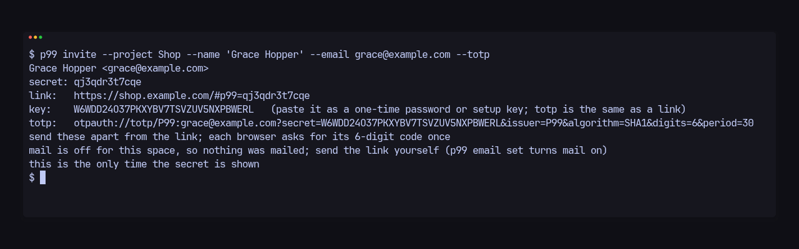</p>

<p align="center">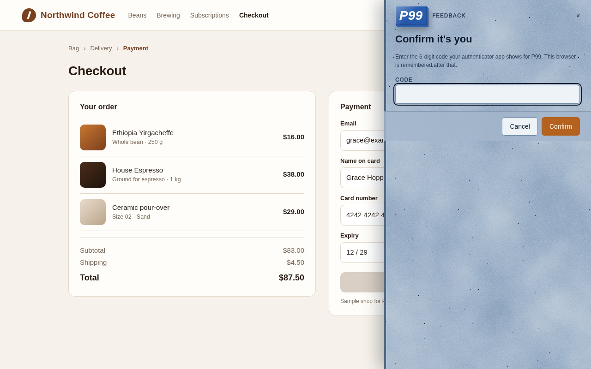 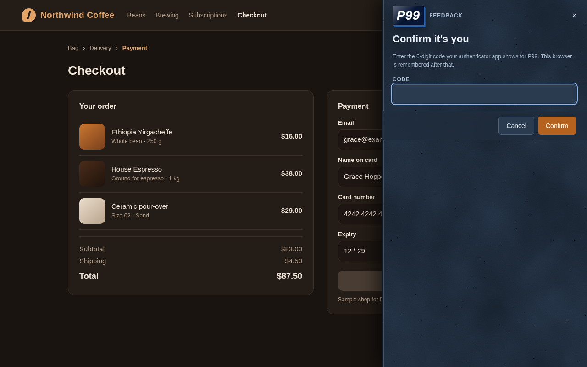</p>

## Access links

When the account has mail on (`p99 email set`), `p99 invite` mails the person their link: one "Open P99 on <host>" button per host the code covers, and the plain `https://<host>/#p99=<code>` lines in the text part, with replies going to whoever sent it. Without mail, or with `--no-mail`, the terminal prints the links once. `p99 revoke <id>` ends a code at once, and `p99 relink <id|email>` gives someone a new code in place of the one they hold: the old code stops working in the same request, the new link is mailed, and their authenticator, items and history carry over, since those follow the e-mail. With an authenticator on the code, a forwarded link alone opens nothing in another browser. Your own links are printed in the terminal, never mailed unless you add `--mail-me`; P99 writes them nowhere, so save them in your password manager if you keep them there. `p99 link [host]` opens your link in the browser from the `code` your config keeps (inline, or an `op://` reference read at that moment), and `--print` prints it. More in [docs/guides/invite.md](docs/guides/invite.md).

## The P99 page

Each account's Worker also answers on an address of its own, so P99 stays reachable when a site is down or its tag is off. It is the account's `workers.dev` address (`https://p99.<subdomain>.workers.dev/`), or a host you set once as `app = "p99.example.com"` for the account in the config, and `p99 deploy` sets it up; `p99 app` prints it. The page has three screens: sign in, your spaces (each site your codes cover, with its open count) and your profile (your username, with its generated disc). Opening a space shows the same panel as on the site, full page: your items and threads, and the board for managers.

Signing in takes your e-mail and the 6-digit code from the authenticator on your P99 code; there are no passwords and no mailed links, so only codes with an authenticator sign in here (`p99 invites totp <id>` adds one). The session is a cookie that lasts 30 days and ends at sign-out, or the moment its code is revoked or relinked. On the page a person sees exactly what their codes see on the sites. More in [docs/security.md](docs/security.md).

## Install and first use

Each [release](https://github.com/gmrdad82/p99/releases/latest) carries a Linux (x86_64) and a macOS (Apple Silicon) binary with a `SHA256SUMS` file. The macOS binary is built on an Apple Silicon Mac.

**Linux and WSL:**

```
v=$(basename "$(curl -fsSLo /dev/null -w '%{url_effective}' https://github.com/gmrdad82/p99/releases/latest)")
mkdir -p ~/.local/bin && curl -fsSL "https://github.com/gmrdad82/p99/releases/download/$v/p99-$v-linux-x86_64.tar.gz" | tar -xz -C ~/.local/bin p99
```

**macOS:**

```
v=$(basename "$(curl -fsSLo /dev/null -w '%{url_effective}' https://github.com/gmrdad82/p99/releases/latest)")
mkdir -p ~/.local/bin && curl -fsSL "https://github.com/gmrdad82/p99/releases/download/$v/p99-$v-macos-arm64.tar.gz" | tar -xz -C ~/.local/bin p99
```

`~/.local/bin` needs to be on your `PATH`. **From source**, with Rust 1.97 or newer: `cargo install --locked --git https://github.com/gmrdad82/p99 --tag vX.Y.Z p99`.

**First use:**

```
p99 tui --demo                      # the inbox on sample data, nothing to set up
p99 setup                           # your Cloudflare account, step by step
p99 invite example.com --name "Ada Lovelace" --email ada@example.com
p99                                 # your inbox
```

Then add the tag to your site's `<head>` and open the link `p99 invite` printed for you.

## More

- [docs/hosts.md](docs/hosts.md): placement, themes, Content-Security-Policy, Cloudflare Access and the pages P99 stays off.
- [docs/config.md](docs/config.md): `~/.config/p99/config.toml`, several accounts and hosts, secrets inline (mode 0600) or as password-manager references. A script sets `P99_TOKEN` rather than passing `--token`, which would land in shell history; every command that talks to Cloudflare takes it over the configured token, so `p99 deploy` runs unattended.
- [docs/import.md](docs/import.md): bring items from another tracker with `p99 import`, keeping their keys and numbers.
- [docs/api.md](docs/api.md): the Worker's HTTP API, signing and its test vector.
- [docs/guides/](docs/guides/): one task a page, also on [docs.pitomd.com](https://docs.pitomd.com/p99/).

## Part of PITO MD

P99 is one of [PITO MD](https://pitomd.com)'s open tools. Its inbox is built on [pito-tui](https://github.com/gmrdad82/pito-tui), the shared terminal app shell. Its clips and stills are recorded with [prec](https://github.com/gmrdad82/prec) and made GIFs with pcod from [pito-codecs](https://github.com/gmrdad82/pito-codecs). Its charts are drawn with [pito-compare](https://github.com/gmrdad82/pito-compare).

## Build and test

```
bin/gate --fast   # fmt, clippy -D warnings, the unit tests
bin/gate          # the same plus the release build
bin/budget        # the loader's 2,048-byte gzipped budget
cd worker && npm ci && npm test   # the Worker's tests on a local wrangler dev
```

## Contributing

Issues and pull requests are welcome on GitHub. A pull request is merged only once its author has signed the [Contributor Licence Agreement](CLA.md); [CONTRIBUTING.md](CONTRIBUTING.md) says how, and what a change needs. Keep changes small, keep the loader under its budget, and run the gate before you push. Please follow the [code of conduct](CODE_OF_CONDUCT.md); report security issues privately as [SECURITY.md](SECURITY.md) says.

## Licence


© 2026 Catalin Ilinca. AGPL-3.0, with a [commercial licence](https://pitomd.com/p99/license/) for closed or paid use.

P99 is free software under the GNU Affero General Public License, version 3 only ([LICENSE](LICENSE)): use it, study it, change it and share it as that licence allows. Closed or paid use takes a commercial licence instead; `p99 license set` stores its key, which is checked offline ([docs/config.md](docs/config.md#licence-key)). Versions up to 1.7.x were released under the MIT licence and stay under it as published.

The AGPL-3.0 and the commercial licence cover the code only: the P99 and PITO MD names and logos are © Catalin Ilinca, all rights reserved ([TRADEMARKS.md](TRADEMARKS.md)). Third-party code and its licence are listed in [NOTICE](NOTICE).
