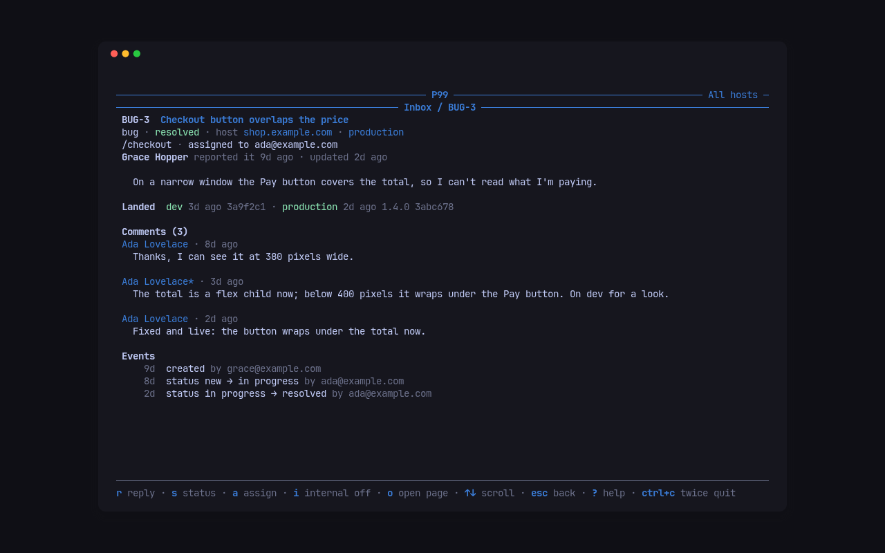
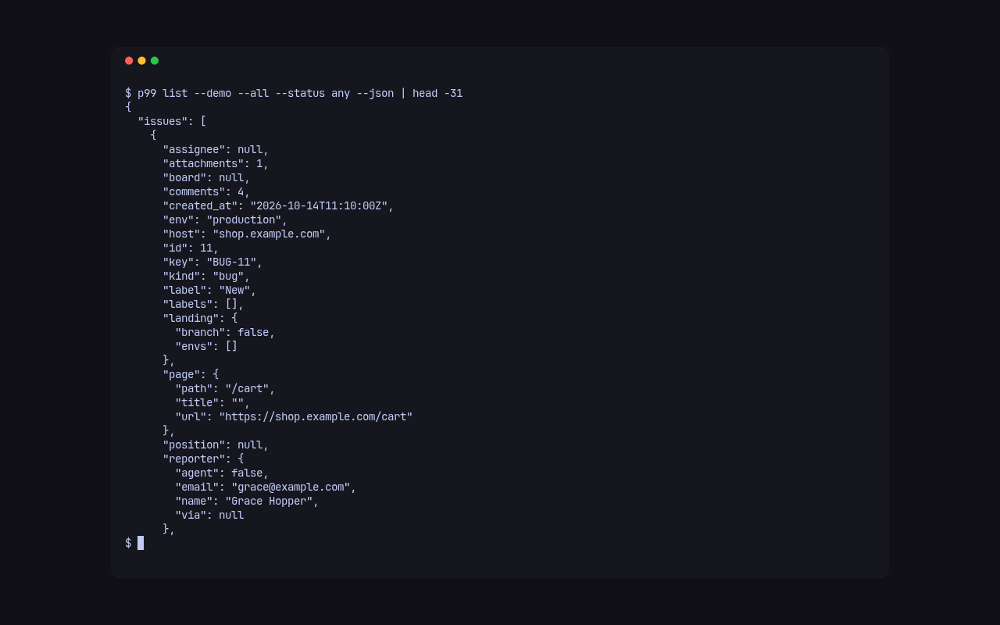

Everything people file lands in one inbox per Cloudflare account, across all its hosts. Work it in the terminal UI, or one command at a time from the CLI.

## Items

An item is a `bug`, `feature` (an idea), `improvement`, `question` or `task` (tasks are filed by managers). Its key is a prefix and a number, `BUG-12`, `FEAT-7`, `IMP-5`, `Q-10`, `TASK-6`, over one numbering per account: any prefix with the right number, or the bare number, names the same item, so `12`, `bug-12` and `BUG-12` all work.

Its status is one of four: `inbox`, `doing`, `review` and `done`. The first three are **open**, `done` is **closed**, and a done item says how it ended: `fixed`, `abandoned` (dropped) or `duplicate` (of another item). The names Inbox, Doing, Review and Done are the account's to change, with `p99 statuses rename doing "In progress"`; the keys stay. Reporters see their own words in the panel: Received, In progress, In review, then Fixed, Dropped or Duplicate. Every change is recorded as an event, and the reporter is mailed about replies and status changes when mail is on.

## Boards

Every item sits on one board, and its column there is its status. Each host has a home board, named after the host (slug `example-com` for `example.com`), where its new items land at the top of Inbox. A board can sit as a card inside another board's column, beside items, and shows how much of everything inside it is done, `3/7`. Moving a board card to a column moves every item inside it, boards within boards included, to that column; moving it to Done marks their open items fixed.

```sh
p99 boards
p99 boards add "Site v2" --in example-com
p99 boards add Checkout --in site-v2 --column doing
p99 board site-v2
p99 move BUG-12 --to doing
p99 move BUG-12 --board site-v2 --after BUG-9
p99 move board:site-v2 --to done
p99 boards rename site-v2 "Site, version 2"
p99 boards remove checkout
```

`--to` takes a status's key or its name, in any case. Without `--before` or `--after`, a card that changes column or board goes to the top. A board without `--host` or `--in` spans every host of the account; one with `--host` holds that host's items only. `p99 boards remove` takes only an empty board, and a host's home board stays.

## The TUI

```sh
p99
```

`p99` alone, in a terminal, opens the TUI, as `p99 tui` does; its flags (`--account`, `--agent`) go with `p99 tui`. Piped or in a script, a bare `p99` prints clap's short error and exits 2 instead of waiting on a screen.

The Inbox screen lists the open items of every host, newest activity first, with a dot on the unread ones; the header counts the items shown and the unread. `tab`, or `1` and `2`, switch between the Inbox and the Codes screens.

| Key | In the list |
| --- | --- |
| `↑` `↓` | move |
| `enter` | open the item |
| `/` | filter by text as you type; `esc` clears it |
| `s` | show open, closed or any status, in turn |
| `h` | show every host, or pick one |
| `r` | read the list again |
| `?` | every key of the screen |
| `ctrl+c` twice | quit |

| Key | In an item |
| --- | --- |
| `r` | write a reply; `enter` sends it, `esc` drops it |
| `i` | make the next reply internal (managers only see it), or not |
| `s` | change the status; `duplicate` then asks for the item it duplicates |
| `a` | assign it to someone, or to no one |
| `o` | open the item's page in the browser |
| `↑` `↓`, `space`, `g`, `G` | scroll |
| `ctrl+r` | read the item again |
| `esc` | back to the list |

An item shows its kind, status, host and environment, the page it was filed on, who reported it, its text, its comments with their files, where its fix has landed, and its events.

## The CLI

The same work, one command at a time:

```sh
p99 list example.com
p99 list --all --status any --kind bug
p99 list --mine -q checkout
p99 show BUG-12
p99 comment BUG-12 "Fixed on dev, can you check?"
p99 comment BUG-12 "The cart caches the total." --internal
p99 status BUG-12 done
p99 status BUG-14 abandoned
p99 status BUG-13 duplicate --duplicate-of BUG-12
p99 assign BUG-12 me
p99 assign BUG-12 --none
p99 file example.com --kind task --title "Move product images to the new bucket"
p99 download 41 -o receipt.png
```

`p99 status BUG-12 done` is `p99 move BUG-12 --to done`; `abandoned` and `duplicate` end an item that way too, and the P99 1.x words (`resolved`, `in_progress` and the rest) still work.

`p99 list` takes a host; without one it lists every host of the account, and `--all` every host of every account in the config. `--status` is `open` (the default), `closed`, `any` or one status, and `--limit` caps the lines at 50 unless you raise it. Its lines read:

```text
*BUG-11   Inbox       shop.example.com The total does not update after removing a line  [4 comments]
 TASK-6   Doing       shop.example.com Move product images to the new bucket  -> ada@example.com
 BUG-8    Doing       dev.example.com Search box loses focus on mobile  -> ada@example.com  [3 comments]  fixed on a branch
 IMP-5    Doing       shop.example.com Show delivery dates on product pages  -> ada@example.com  landed: dev
```

A `*` before the key marks it unread. `p99 show` prints the item, the commits that named it, its files with the ids `p99 download` takes, its comments (internal ones marked) and its events. A comment or a file body of `-` is read from standard input, and `--attach <file>` adds files to `p99 file` and `p99 comment`: images, PDFs, text, CSV, JSON, zip and office files, up to 20 MiB each.

## JSON for scripts



Every command takes `--json` and then prints one JSON document on standard output: `p99 list --json` prints `{"issues":[…]}` with each item's summary, and `p99 show --json` the whole thread, `{"issue","comments","attachments","events"}`. The objects are the Worker's own, described field by field in [the API reference](../reference/formats.md#items):

```sh
p99 list --all --json | jq -r '.issues[] | select(.unread) | .key'
```

## Next

- [Let agents work the inbox](agents.md): the same commands, marked as an agent's.
- [Announce builds and landings](announce.md): show on each item where its fix is.
