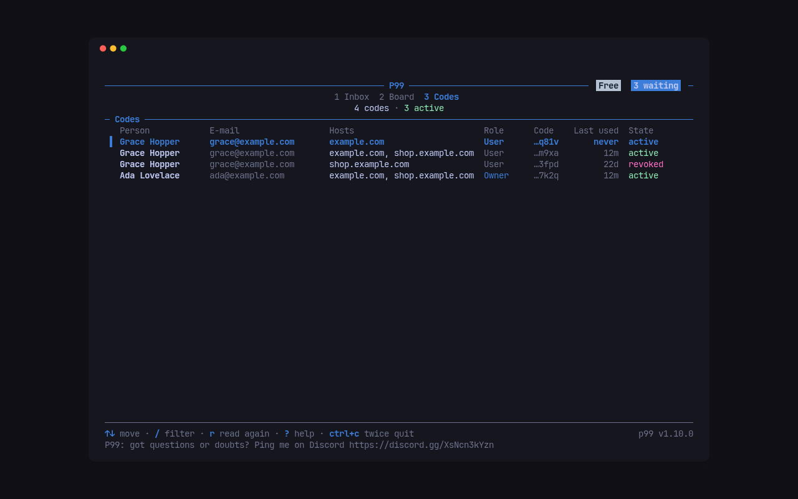

P99 has no accounts and no sign-up. Each person you invite gets a **personal code**, 12 characters, for one or more hosts of one account. The "+" shows only in a browser that holds a code; everyone else sees nothing.

## Mint a code

```sh
p99 invite example.com shop.example.com --name "Grace Hopper" --email grace@example.com
```

```text
Grace Hopper <grace@example.com>
secret: <code>
link:   https://example.com/#p99=<code>
link:   https://shop.example.com/#p99=<code>
this is the only time the secret is shown
```

In place of `<code>` it prints the 12 characters of the new code. Send the person a link. They open it once: the page keeps the code in the site's `localStorage` and removes it from the address bar and the history entry at once. The code sits in the link's fragment, which the browser never sends to a server, so it stays out of your server's, Cloudflare's and any analytics' logs and `Referer` headers. Treat the link as the secret it is. P99 keeps only the code's SHA-256, so a lost secret can't be shown again: mint a new code.

`--json` prints the code object, the secret and the links, for a script that sends the invitations.

## Members and managers

A code holder files bugs, ideas, improvements and questions, and sees and follows only what they reported. Add `--manager` to let the person see and change every item, file tasks and write internal comments:

```sh
p99 invite example.com --name "Ada Lovelace" --email ada@example.com --manager
```

The e-mail you gave `p99 setup` is a manager from the start: it is in the Worker's `MANAGERS` secret, and so is anyone you add there.

Each code is limited to 120 requests a minute, and a member to 30 items, 200 comments and 100 MiB of files a day. Managers have no daily limits.

## See who holds a code

```sh
p99 invites
p99 invites --host shop.example.com
```

```text
   1  active  Ada Lovelace <ada@example.com>  manager  ...7k2q  2026-09-14 12:00  hosts: example.com, shop.example.com  last used: 2026-10-14 11:48
   2  revoked  Grace Hopper <grace@example.com>  member  ...3fpd  2026-09-19 12:00  hosts: shop.example.com  last used: 2026-09-22 12:00
   3  active  Grace Hopper <grace@example.com>  member  ...m9xa  2026-09-23 12:00  hosts: example.com, shop.example.com  last used: 2026-10-14 11:48
```

Each line is the code's id, its state, the person, the role, the secret's last four characters, when it was made, its hosts and when it was last used. In `p99 tui`, `tab` switches to the same list on the Codes screen, with `/` to filter it.

## Revoke a code

```sh
p99 revoke 3
```

```text
revoked code 3 of Grace Hopper <grace@example.com>
```

The next request with that code answers 401, and the loader forgets it, so the "+" disappears from that browser. The person's items and comments stay. To give someone a new code, mint one; a code can't be changed or shown again.

## Next

[Work the inbox](inbox.md): read and answer what people file.
