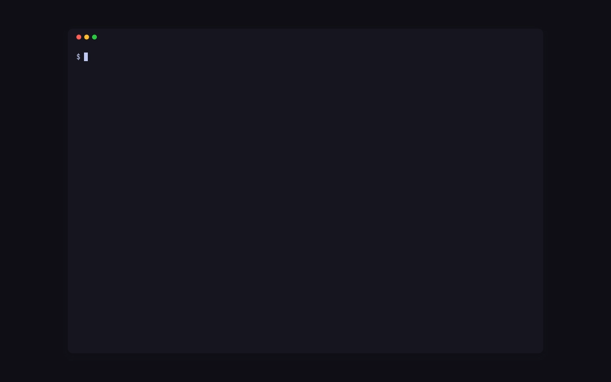

`p99 setup` puts P99 on one Cloudflare account: one D1 database, one R2 bucket and one Worker, mounted on each of your hosts as `<host>/_p99/*`. It runs in nine steps, checks what exists before it creates anything, and saves the config after each step, so it is safe to run again: it picks up where it stopped.

## Before you start

You need a Cloudflare account whose zones hold your sites' hostnames, and an API token for it. Create the token in the dashboard under **My Profile › API Tokens › Create Token › Custom token** (or, for a token the account owns, **Manage Account › Account API Tokens**), limit it to the account and the zones of your hosts, and give it these permissions:

| Permission | Why P99 needs it |
| --- | --- |
| Account › Workers Scripts: Edit | upload the P99 Worker with its Durable Object, set its secrets and its cron schedule |
| Account › D1: Edit | create the D1 database and apply its migrations |
| Account › Workers R2 Storage: Edit | create the R2 bucket that keeps attachments and backups |
| Zone › Workers Routes: Edit | add the route `<host>/_p99/*` on each host's zone |
| Zone › Zone: Read | find the zone each host belongs to |

Setup prints the same list when it asks for the token, and checks the token against Cloudflare before it creates anything; a missing permission is named, and setup waits for you to edit the token and paste it again. The zone permissions are checked only on the zones of the hosts you name with `--host`, and P99 never calls the API on any other zone of the account, so a token limited to those zones is enough.

## Run it

```sh
p99 setup
```

The steps and what each asks:

1. **You.** Your name, as P99 shows it, and your e-mail, which becomes the space's first Owner. The CLI and the TUI act as you. The first time, they go to `[me]`; when you add another space, setup asks whether you act as that same person there, and a different name or e-mail (or `--name` and `--email` that differ from `[me]`) goes to that space's `[spaces.<name>.me]` ([the configuration](../reference/formats.md#configuration)).
2. **The Cloudflare token.** Setup asks [where it comes from](#where-the-secrets-go): pasted without echo, a file, an environment variable or a command. When the token reaches several accounts, setup lists them and asks which one.
3. **The D1 database** `p99`, which keeps items, comments, events, codes, hosts and environments.
4. **The schema.** Migrations are applied in order and recorded in `d1_migrations`, as wrangler records them.
5. **The R2 bucket** `p99`, which keeps screenshots, attachments and the weekly backups.
6. **The key.** 32 random bytes the CLI and the TUI sign every request with, or a key you already keep in a file, a variable or a command (`--key-from`); the Worker holds the same key as its secret `KEY_P99`.
7. **Mail (optional).** P99 sends no mail by default: the TUI is the inbox. Answer yes to say where a Resend API key comes from and give a sender such as `P99 <p99@example.com>`; P99 then mails Owners about new items and reporters about replies, status changes and fixes. The sender's domain must be verified with Resend. The key goes to the Worker as its secret `RESEND_API_KEY`. A pasted key is kept nowhere else; a key from a file, a variable or a command is kept as that source, so the next run reads it again; `p99 email` changes it later.
8. **The Worker,** uploaded with its bindings (`DB`, `BUCKET`, `RATE`, `VERSION`, and `HUB`, the Durable Object that holds the live streams of `p99 tui` and `p99 watch`; SQLite-backed Durable Objects are on the Workers free plan), its secrets (`KEY_P99`, `MANAGERS`) and a cron schedule for the backups. Setup picks a rate-limiting namespace no other Worker in the account uses.
9. **The hosts.** The hostnames this account serves, comma separated, and each one's environment and kind. A host has one environment: `production` (a `release` kind) by default; a development address is its own host, with an environment such as `dev` (a `development` kind). Each host gets the route `<host>/_p99/*` on its zone. A Pages project, Custom Domain or Worker already serving the host is named and left as it is: the route only runs in front of it for `/_p99/*`.

Setup ends by checking that each host answers this version on `/_p99/health`, then prints a summary:

```text
The space main is set up:
  Cloudflare account  3f9c2a7d41e84b6a9d0c5e1f72a8b4c6
  Worker              p99 (0.1.0)
  D1 database         p99 (12d2a079-30df-4c8a-a157-928072cc1523)
  R2 bucket           p99
  key                 p99, in the config (mode 0600)
  mail                off
  host                dev.example.com (dev)
  host                example.com (production)
  config              ~/.config/p99/config.toml

Put <script src="/_p99/p99.js" async></script> in your pages' <head>, then invite people:
  p99 invite dev.example.com --name "Ada Lovelace" --email ada@example.com
```

## Where the secrets go

For each of the Cloudflare token, the P99 key and the Resend key, setup asks where it comes from:

1. **Paste it** (for the key, make a new one). The value is written to `~/.config/p99/config.toml` with mode 0600, and P99 refuses a config file anyone else can read. The Resend key is the exception: it goes to the Worker and nowhere else.
2. **A file only you can read.** P99 refuses a file the group or others can read.
3. **An environment variable.**
4. **A command that prints it**, such as `pass show p99/token` or `bw get password p99`. P99 runs it with no shell, and gives it 20 seconds.

The config then holds the source, never the value:

```toml
[spaces.pito]
token = { command = ["pass", "show", "p99/token"] }
key = { file = "~/.config/p99/key" }
resend_key = { env = "RESEND_API_KEY" }
```

A secret given as a plain string, or as a password-manager reference string, keeps working. When a password manager CLI is installed, setup also offers to keep a pasted secret there and writes only a reference to the config; `--vault <name>` picks the vault and `--no-vault` keeps it in the file. Nothing needs a password manager. [The configuration reference](../reference/formats.md#configuration) lists every key.

## Without questions

Every question has a flag, and `--yes` takes the default for the rest, so a script can run setup end to end. Pass the token and the Resend key in the environment, never as flags, so they stay out of the shell history and `ps`. `--token`, `--resend-key` and `--key-from` also take a source instead of a value: `env:NAME`, `file:PATH` or `command:WORDS` (split on spaces, quotes keep a run whole), which the config then keeps as `{ env = … }`, `{ file = … }` or `{ command = [ … ] }`:

```sh
export P99_TOKEN=…
p99 setup --yes --name "Ada Lovelace" --email ada@example.com \
  --account-id 3f9c2a7d41e84b6a9d0c5e1f72a8b4c6 --no-mail \
  --host example.com --host dev.example.com=dev:development
```

`--host` takes `host[=env[:kind]]` and repeats. `--json` prints the summary as JSON, with each host's route, health and notes, and sends the step lines to standard error.

## Mail later

`p99 email set` turns mail on for a space, or changes it, without running setup again:

```sh
p99 email set --provider resend --key-ref env:RESEND_API_KEY --from "P99 <p99@example.com>"
```

`--key-ref` names where the key comes from: `env:NAME` for an environment variable, `file:PATH` for a file only you can read, or `command:WORDS` for a command that prints it. P99 reads the key, checks with Resend that the sender's domain is verified, puts the key in the Worker as its secret `RESEND_API_KEY` and the sender in the database; the key never touches a file. A key made for sending only can't list domains: P99 then says it couldn't check, saves it anyway, and `p99 email show` keeps that note. `p99 email show` prints the provider, the sender and whether the Worker holds a key (`--json` too), and `p99 email off` turns mail off and removes the key from the Worker. Each takes `--space`.

## More than one space

Run `p99 setup --space <slug>` with a token for another Cloudflare account: it adds that space beside the first, and the others stay as they are. Every command then takes `--space <slug>`, and a command that names a host uses that host's space. Run `p99 setup` again at any time to add hosts or finish a setup that stopped; it picks up the space it finds in the config.

## Next

- [Put P99 on a site](site.md): the tag, the button's place, Content-Security-Policy and Access.
- [Invite people](invite.md): personal codes and their links.
