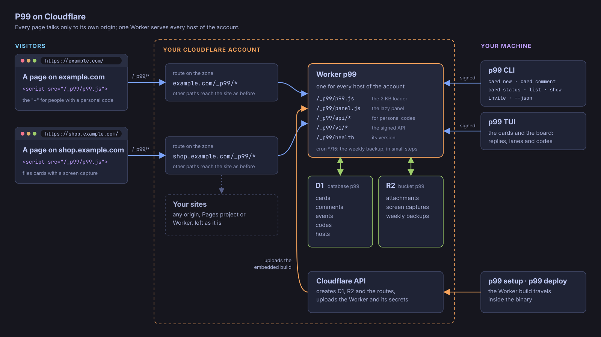

Each site P99 serves is a **host**: a hostname on one of your Cloudflare zones. The Worker answers on `https://<host>/_p99/*` through a Worker route, so your pages talk only to their own origin. Everything else on the host reaches your site as before.

## 1. Add the host

`p99 setup` adds the hosts you name. To add one later:

```sh
p99 hosts add shop.example.com --project Shop --env production
p99 hosts add dev.shop.example.com --project Shop --env dev --kind development
```

`--project` is required: a host belongs to one project, cards filed on it land in that project, and the project must exist (`p99 projects add <name>` makes one). `hosts add` writes the host to your config, adds the route `<host>/_p99/*` on its zone and tells the Worker the host's environment. A new environment is a `release` unless `--kind development` says otherwise. A site with a production and a development address makes them two hosts with their own environments, so their cards stay apart and share one numbering.

`p99 hosts` lists every host with its space, project, environment, how many areas it masks, whether captures are on, and whether the Worker answers. `p99 hosts set <host> --project <name>` moves a host to another project, and its cards move with it. `p99 spaces` lists the spaces in your config; `p99 projects` lists a space's projects with their hosts and counts, and `p99 projects add` and `p99 projects rename` change them. `p99 hosts remove <host>` takes a host off the Worker and out of the config; its cards stay, and so does its route in Cloudflare.

## 2. Add the tag

One tag in the shared `<head>` of every page:

```html
<script src="/_p99/p99.js" async></script>
```

The loader is under 2 KB gzipped. It draws the "+" only for people holding a personal code and does nothing for anyone else; the panel and the screen capture load only when the "+" is pressed. Shipping the tag before the route exists is harmless: the script fails to load and nothing is drawn.

## 3. Place and theme the button

Nothing else goes in the page: the button's corner, offset, theme and words come from the host's config, which the Worker writes into the loader it serves for that host.

```sh
p99 hosts set shop.example.com --corner bottom-left --offset 24,24
p99 hosts set shop.example.com --above "#cookie-banner"
p99 hosts set shop.example.com --theme accent=#3b7dd8 --string file=Send
p99 hosts set shop.example.com --off "/checkout/*/done" --off "/admin/**"
```

- `--corner` is `bottom-right` (the default), `bottom-left`, `top-right` or `top-left`; `--offset X,Y` is in pixels from the corner's two edges.
- `--above` names an element the button sits above while it is visible, such as a cookie banner.
- `--theme key=value` sets a `--p99-*` custom property without its prefix, and `--string key=value` replaces one of the panel's English words; an empty value removes either.
- `--off` lists the paths where P99 never loads (`*` matches one segment, `**` any); repeat it, and the list replaces the old one.

The same keys live in the host's table in the config (`[hosts."shop.example.com"]`), where a `dark` table inside `theme` holds the dark-mode values; `p99 hosts set` pushes them to the Worker. [The host reference](../reference/hosts.md) lists every key.

## 4. Keep pages private

- A page carrying `<meta name="p99" content="off">` never loads P99, nor does any path in the host's `off` list: there the loader draws nothing, reads nothing and captures nothing.
- `data-p99-redact` on an element blanks it in every capture and keeps its text out of marked regions; `data-p99-ignore` leaves it out of captures altogether.
- The person filing can uncheck "Hide this site's private areas" to send those areas, and the host's `mask` areas, as they are; password fields and what was typed in those areas stay blanked, and the preview shows what goes.
- Addresses are recorded without their query string and hash.

## 5. Content-Security-Policy

P99 works under a strict policy such as:

```text
default-src 'none'; script-src 'nonce-…' https://shop.example.com/_p99/; connect-src 'self'; style-src 'self'; img-src 'self'; frame-src 'self'; font-src 'self'; frame-ancestors 'none'
```

Give the tag the page's nonce, and allow the `https://<host>/_p99/` path in `script-src`: the loader imports `panel.js` and `capture.js` from there. P99 styles its Shadow DOM through constructable stylesheets only, so `style-src` needs no `'unsafe-inline'`. It fetches only same-origin URLs, uses no inline handlers, `eval` or workers, and adds one element and one global, `P99`, to the page. `default-src 'self'` alone is enough. Captures are decoded in one hidden same-origin frame, `/_p99/frame.html`, so `img-src` needs no `data:` or `blob:` as long as `frame-src` allows `'self'`; [The host reference](../reference/hosts.md#content-security-policy) has the details.

## 6. Hosts behind Cloudflare Access

A host behind Cloudflare Access keeps `/_p99/*` behind Access: the browser already carries the Access cookie, so the page's requests pass. The CLI, the TUI and `p99 announce` carry no cookie. They reach the Worker through any host of the space, skip one that answers with Access's login and keep the one that answered, so a public production host next to a private `dev` host needs nothing more. When every host of the space is behind Access, give them one of two ways in:

- point the space's `url` in the config at an address of the Worker that is not behind Access, such as a custom domain of its own; or
- create an Access service token for the application and set the space's `access_client_id` and `access_client_secret`: every request then carries `CF-Access-Client-Id` and `CF-Access-Client-Secret`.

Either way, P99's own signature still guards every request. `p99 setup` and `p99 deploy` show a host behind Access as such, not as a failed check.

## Next

[Invite people](invite.md): the "+" shows only for someone holding a personal code.
